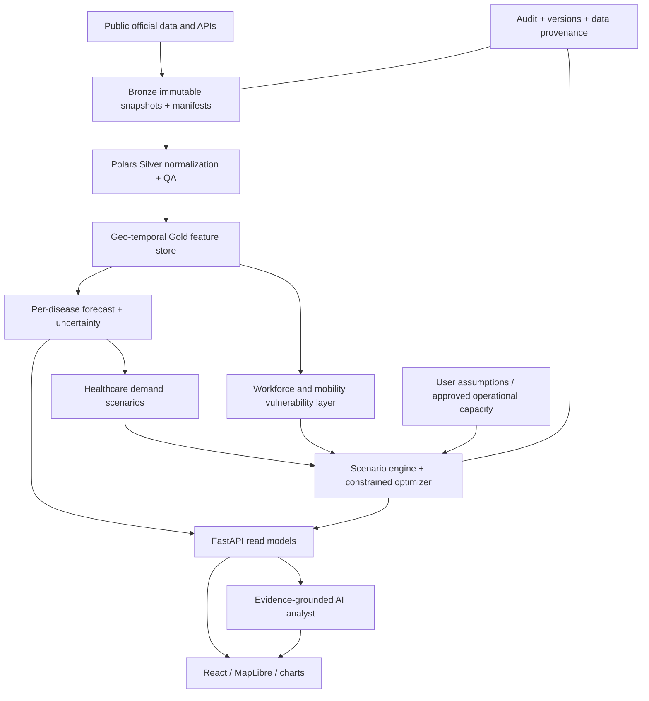
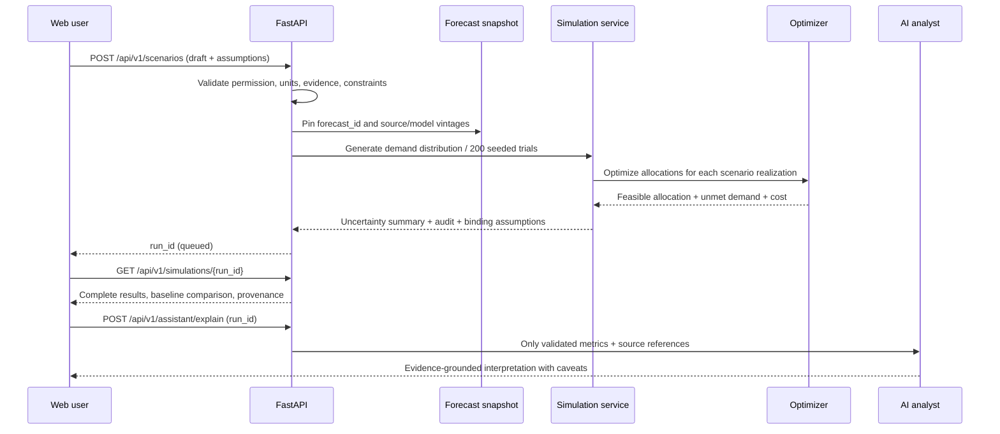

# HEALTHPULSE 3.1
## Detailed Implementation Plan — Climate, Mobility, Multi-Disease Intelligence, AI Simulation & Admin ML Studio

**Version:** 1.1 | **Date:** 2026-11-02 | **Track:** Climate-Resilient Worker Health  
**Deliverable:** Working, data-connected web application + reproducible forecast & scenario workflows  
**Status:** Implementation specification, NOT a claim that the new web or simulation modules already exist.

> **North Star:** Transform fragmented climate, disease, mobility, workforce and healthcare signals into transparent forecasts and locally actionable, auditable response scenarios. Human experts remain in control.

---

## 0. Executive implementation brief

HealthPulse combines eight data groups: (1) Brazil Dengue Multimodal / InfoDengue, (2) SIVEP-Gripe, (3) Meta Mobility / IBGE commuting, (4) Nager.Holidays, (5) Open-Meteo, (6) WorldPop / geoBoundaries, (7) IBGE CEMPRE and (8) CNES facilities / registered beds. The existing Python/Polars repository already provides ingestion and normalization scaffolding, a weekly features table, proof-of-concept count forecasting, and a basic allocation optimizer. It is **not yet** a validated operational public-health service.

Implement four tightly connected products:

1. **Intelligence Web View:** a real interactive map, time slider, disease dashboards, workforce exposure, facility capacity and source provenance, all backed by APIs and actual loaded records rather than decorative static mock data.
2. **Forecast Engine:** disease-specific municipality/week forecasting of observed dengue counts and severe respiratory case signals (COVID-19 SARI / influenza SARI), with baselines, prediction intervals, performance reports and freshness indicators.
3. **AI Simulation Studio:** a deterministic and stochastic decision-support engine comparing no-action versus explicitly configured scenarios. It models demand and resource capacity, optimizes assignments under constraints, and explains outputs through a grounded AI analyst. Any *disease-transmission* intervention effect is optional, conditioned on credible calibrated evidence, and labeled **hypothetical**.
4. **Admin & AI Development Studio:** role-gated data source management, quality-controlled ingestion, point-in-time feature store, built-in experiment training/backtesting, MLflow-backed registry and reviewed deployment. Administrative actions create versioned, auditable artifacts rather than changing published results silently.

### MVP contract (must ship)

- One coherent end-to-end Brazil pilot (three initial municipalities, optionally expand after QA).
- Dengue as primary forecasting demonstration; COVID-19 SARI and influenza SARI as separate documented secondary signals where data pass QA.
- A map showing historical observed indicators, actual forecast files and facility locations, with real filters and region drill-down.
- A simulation that takes the displayed forecast into a health-service demand estimate, applies transparent resource constraints, and returns a baseline-vs-proposal comparison on the same map.
- Every card/chart/assistant answer surfaces **what is observed / predicted / scenario assumption / synthetic**, its date, geography, and source.
- A reproducible one-command local stack (`docker compose up --build`) once implementation is complete, plus offline fixture mode.
- A usable Admin P0 vertical slice: inspect sources, trigger an actual ingestion, validate PIT feature set, run a bounded dengue training experiment, compare baseline metrics and trace a published forecast back to its snapshots. Advanced multiuser governance is P1.

### Out of MVP / prohibited claims

- No validated infection probability per person, no diagnosis, no automatic lockdown recommendations.
- No claim that climate change alone causes COVID-19/influenza waves.
- No use of municipality employment counts as case counts by occupation.
- No claim that CNES registered beds equal free beds; realistic operational capacity requires user-provided or integrated availability.
- No claim of a causal number of cases prevented based purely on an optimized resource allocation.

---

## 1. Background, challenge alignment and significance

**Problem.** Climate variability, extreme weather, migration and commuter networks, seasonal holidays, and unequal healthcare access interact with infectious disease dynamics and health service demand. Public sources typically differ in geographic scale, update intervals, reporting delays and disease definitions. Local health administrators and employers often cannot jointly inspect these signals or test whether their preparedness resources will cover expected demand.

**Public-health need.** Forecasting alone is not a response plan. Teams need to identify *where*, *which disease*, *which workers and communities*, *when*, *how much operational pressure*, and *which feasible response action*.

**Alignment with Climate-Resilient Worker Health.** Occupational vulnerability is a first-class analytic layer, not an afterthought: identify workforce distribution by sector; show workplace/commuting exposure proxies; evaluate continuity of essential services and fair access to preventive outreach; surface facility readiness for workers who live in one municipality and work in another. Sector exposure is contextual, not a proven sector-specific infection rate.

**Primary users and decisions:**

| User | Decision | Product surface | Safety constraint |
|---|---|---|---|
| Local public-health officer | Where should field teams inspect or deploy next week? | Risk map + Scenario Studio | Must review epidemiological evidence and intervention protocol |
| Facility manager | Where might visits exceed registered/planned capacity? | Facilities & Capacity | Available staffing and beds require confirmed operational inputs |
| Occupational health / employer | Which locations and sectors may need targeted communication? | Workforce Lens | Do not identify individual worker illness or infer diagnoses |
| Data scientist / epidemiologist | Is mobility improving forecasts beyond climate? | Model Lab & Data Lab | Show temporal leakage tests and calibration |
| Regional coordinator | How to distribute limited teams fairly? | Resource Optimizer | Equity and minimum service constraints are non-negotiable |

**Meaning of the system:** shift from reactive dashboards to documented, auditable *preparedness decisions*. Success is improved forecast calibration, clearer early warning, lower simulated service shortfall and transparent decision time—not unverified numbers of lives saved.

---

## 2. End-to-end architecture



**Backend:** Python 3.11+ for new components; existing Polars/Parquet pipeline; FastAPI + Pydantic v2; DuckDB optional for read-only aggregations; SciPy MILP already present, optional OR-Tools for richer scheduling and network flows; Redis + RQ/Arq optional for long simulation jobs (simple local process pool in MVP); SQLite in local MVP for runs/auth/demo settings, PostgreSQL/PostGIS when deploying beyond pilot.

**Frontend:** React + TypeScript + Vite, TanStack Query, MapLibre GL JS for vector map, ECharts or Recharts for series and uncertainty bands, Zustand (local selection state), Tailwind CSS or CSS tokens. No static chart JSON except explicitly marked fixture mode. Use PMTiles/vector tiling for larger geographies; simplified GeoJSON is acceptable for three pilot municipalities.

**Deployment:** Docker Compose (`api`, `web`, optional `worker`), bind-mounted immutable `data/raw`, versioned data/forecast artefacts, read-only public demo role and authentication for saved scenarios. Keep public demo aggregated; never expose raw identifiable health records.

**Model lifecycle:** source registry -> immutable snapshots -> PIT-validated feature registry/set -> pinned training dataset -> bounded train/backtest job -> model registry + manual approvals -> published forecast version -> version-pinned simulation -> monitoring. Detailed admin/workflow contracts are specified in sections 17–25. Keep published forecast versions immutable so old simulations reproduce.

---

## 3. Dataset ingestion and canonical contracts

### 3.1 Source inventory and real-availability policy

| Source | Key grain | Use | Download/integration | Limitations / fallback |
|---|---|---|---|---|
| Brazil Dengue Multimodal | municipality-week | dengue training | Zenodo frozen Parquet; curated allowlist | Retrospective feature leakage audit required |
| InfoDengue | municipality-week / release | dengue nowcast & updates | API selected codes/year | Revised backfill: store every ingestion vintage |
| SIVEP-Gripe | case-level -> aggregated municipality-week | severe COVID-19 / influenza SARI | Brazil open-data export, aggregate in Silver | Not population incidence; missing outcomes and report lag |
| Meta Movement Distribution | geographic unit-day | travel-distance intensity | download authorized public export; crosswalk polygon to IBGE | Not OD matrix, variable public availability |
| IBGE commuting | origin-destination census | structural OD proxy | official census export normalized to edges | Historical/periodic, not observed daily flow |
| Nager.Holidays | country-date | predictable calendar events | HTTP year calendar | National holidays != full local events/school calendars |
| Open-Meteo | lat/lon-hour, issued_at | history and forward forecast | archive/current/forecast APIs | Reanalysis != forecasts available at past issue time |
| WorldPop / geoBoundaries | region/year + polygon | population exposure / geometry | raster extraction and validated crosswalk | Raster estimation and boundary mismatch |
| IBGE CEMPRE | municipality-year-sector | workforce / industry | verified SIDRA extract with table metadata | Formal workforce, not individual disease rates |
| CNES facilities / beds | facility-month | registered capacity | official data export normalized by competence | Registered capacity != operational availability |

**Data release classes:** `LIVE_EXTERNAL` (fresh upstream), `RELEASED_PERIODIC` (weekly/monthly), `SLOW_MOVING` (census), `PLANNER_INPUT` (operational assumptions), `SYNTHETIC_FIXTURE` (development). Every UI response includes a class.

### 3.2 Bronze: immutable and identifiable snapshots

Path: `data/raw/{source}/ingested_at=YYYYMMDDTHHMMSSZ/{filename}`. Manifest fields:

```json
{
  "source_id": "infodengue",
  "source_url": "https://info.dengue.mat.br/",
  "retrieved_at": "2026-11-01T12:00:00Z",
  "available_at": "2026-11-01T12:00:00Z",
  "period_start": "2025-01-01", "period_end": "2026-10-25",
  "geographic_level": "municipality", "license": "verify-at-source",
  "sha256": "<computed>", "schema_version": "1.0",
  "record_count": null, "status": "downloaded"
}
```

Bronze MUST be append-only. Retrying a download generates a new snapshot if bytes change; skip duplicate hash otherwise. Check HTTP content type and file magic; reject HTML served as CSV/ZIP. Use backoff/rate limits and avoid nationwide queries where pilots suffice. Store URLs and terms; dataset reuse rights need verification per source.

### 3.3 Silver schemas (illustrative, types enforced in code)

**Geo authority:** `municipality_dim(municipality_id: Utf8[7], name, state_id, centroid_lat, centroid_lon, geometry_version, valid_from, valid_to)`; crosswalk geoBoundaries geometry to official IBGE polygon and verify one-to-one. Never join by free-text names alone.

**Disease:**

```text
silver/disease_weekly
 municipality_id: Utf8[7]   week_start: Date(Sunday)
 disease_id: Enum[dengue,covid19_sari,influenza_sari,other_sari]
 observed_cases: Int64 nullable  estimated_cases: Float64 nullable
 signal_type: Enum[notification,sari_admission,estimated_count]
 as_of: Datetime(UTC)  available_at: Datetime(UTC)
 source_id: Utf8  vintage_id: Utf8  quality_flags: List[Utf8]
 UNIQUE (municipality_id, week_start, disease_id, source_id, vintage_id)
```

**Climate:** `municipality_id, measurement_time, t2m_c, rh_pct, rain_mm, wind_mps, radiation, source_kind(observed_reanalysis/issued_forecast), forecast_issued_at, valid_time, source_id`. Aggregate to `weather_weekly` using source-specific lag rules; count hourly coverage.

**Mobility:** `municipality_id, date, movement_0_10km_share, movement_10_100km_share, movement_gt100km_share, source, available_at`, plus *separate* `commuting_od(origin_id,destination_id,census_year,commuters,source)`.

**Holiday:** `date, country_code, subdivision(nullable), holiday_type, holiday_name, known_at` and materialize each epidemiological week (holiday observed / preholiday / postholiday). Known scheduled holiday features may include future dates; unforeseen mass-gathering attendance cannot.

**Workforce:** `municipality_id, year, cnae_sector, formal_workers, source, available_at`; retain sectors separately and derive `worker_distribution` views.

**Healthcare:** `facility_id, municipality_id, snapshot_month, facility_type, registered_beds, recorded_staffing(nullable), source, available_at`. Use `facility_capacity_override(facility_id, effective_date, verified_available_beds, teams, staff_hours, planner_id, expires_at)` for authorized operational inputs.

**Population:** `municipality_id, reference_year, population_estimate, age_profile(optional), source, available_at`.

All missing values are `null`, never converted to 0 by default. SIVEP personal records must be aggregated immediately and raw access restricted / retention-reviewed.

### 3.4 Gold schemas

- `gold/features_weekly`: `(municipality_id, week_start, disease_id, feature_set_version)` with only point-in-time eligible features, lagged case/climate/mobility, holiday, employment shares, population and imported-pressure proxy.
- `gold/forecast_weekly`: `(forecast_id, model_version, municipality_id, issue_week, target_week, horizon_weeks, disease_id, predicted_cases, p10, p50, p90, measured_target, source_vintage_id, created_at, quality_status)`.
- `gold/health_demand`: `(forecast_id, municipality_id, facility_catchment_id, target_week, disease_id, visits_p10/p50/p90, admissions_p10/p50/p90, assumptions_version)`.
- `gold/map_snapshot`: aggregated, non-identifiable `region + week + layer + value + semantics + data_status`, cached and served to MapLibre.

### 3.5 Joins and time semantics

1. Calendar: Brazil epidemiological week starts **Sunday**. Store original source week and calendar conversion version.
2. Build explicit `region_week_spine` for each target/source; join on municipality/week for environmental data; `asof(backward)` for monthly healthcare and annual workforce **using available_at**, not only year/month.
3. Many-to-one cardinality validation before every join. Never silently duplicate disease counts when joining sector/facility granularity: aggregate sectors/operational units into views or join them in dedicated detail endpoints.
4. Reconstruct at `forecast_issue_at`: select the latest source vintage actually released by then; use archived issued weather forecasts rather than revised future observed climate.
5. For commuting-based imported pressure: `sum(commuters_j_to_i * prior_week_cases_j / population_j)` as a proxy; not a count of imported infections. Missing OD => feature absent, not invented.
6. Cross-region feature: make disease-specific, direction-aware and lagged. Dengue additionally requires vector suitability; never treat human OD alone as sufficient for local dengue spread.
7. Store lineage: `forecast_id -> model_version -> feature_set_version -> source_vintage_ids`.

### 3.6 Data quality gates

- Unique keys, nonnegative cases/population/registered beds, region crosswalk 100% for pilot (otherwise explicit quarantine), holiday dates valid, geographic levels intact, no PII in Gold.
- Weather weekly hourly coverage >= 90% (configurable); missing weather or disease releases report their precise gaps.
- For each feature, assert `available_at <= forecast_issue_at` on backtest/inference; archive meteorological issue times for forecast inputs.
- Disease labels differentiated: dengue notifications vs COVID-19 **SARI** vs influenza **SARI**. Rates compare only compatible denominators and signals.
- Reconciliation test for facility aggregation: sum of facility registered beds equals municipal summary per period where source supports it.
- No duplicate `facility_id, snapshot_month, bed_type` before aggregation.

---

## 4. Forecasting, workforce intelligence and uncertainty

### 4.1 Model targets and baselines

- **Dengue:** municipality-week counts or estimated counts as separate targets; never mix notification and revised estimates in one label.
- **COVID-19 SARI / influenza SARI:** weekly classified severe respiratory cases, not all community infections.
- Horizons: `h ∈ {1,2,3,4}` weeks. MVP separate models per disease × horizon, using `HistGradientBoostingRegressor(loss="poisson")` from existing repo; baseline persistence, seasonal naive, historical median.
- Move to LightGBM, Negative Binomial, quantile or ensemble only where cross-validation warrants. Retain transparent baselines to avoid complexity without value.
- Exogenous information at inference must be known or forecast at issue time: lagged mobility and weather; future holidays known in advance; future mobility treated as forecast/assumption.

### 4.2 Point-in-time validation and performance

- Rolling-origin cross-validation by **issue date**, using only labels whose results were released by then; freeze test years and independent municipalities for geographic transfer tests.
- Metrics: MAE, WAPE, signed bias, outbreak recall/precision (threshold co-defined with public health experts), p10–p90 empirical coverage, interval width; show each disease and horizon independently.
- Ablation: cases only -> climate -> holidays -> mobility -> commuter graph. Add workforce for equity/service-planning, not as causal proof of infection.
- Calibrate 80% predictive interval from out-of-fold residuals or quantile modeling; check empirical coverage per disease, low-incidence regions and holiday weeks.
- With unreliable data, publish baseline / insufficient-data state rather than overconfident model output.

### 4.3 Workforce vulnerability layer

Compute a **transparent and deconstructable** vulnerability index, not a medical diagnosis:

`index = weighted_percentile(estimated_exposed_workers, commuting_dependence, outdoor_work_share_proxy, local_health_access_gap, hazard_level)`.

Only use workforce-sector occupation/environment proxies with documented assumptions. Present raw denominators and sensitivity to weights, plus fairness tests for small municipalities and missing data. Business-facing views show aggregate regions and recommended communication, not named employees.

---

## 5. AI Simulation Studio — three scientifically separated engines

The simulation mechanism has **three distinct types of results**. UI/exports must never conflate them:

1. **A. Statistical forecast (forecast):** predicted disease indicator given recent signals; no intervention causality claimed.
2. **B. Operational simulation (defensible MVP):** given forecast demand, assumed triage rates, real/planner-entered supply, estimate queue/capacity shortfall and optimized allocations.
3. **C. Transmission what-if (research mode, later):** simulate hypothetical changes in disease dynamics under explicitly calibrated transmission and intervention assumptions; these are *not* measured program effects.

### 5.1 User-visible scenarios

- **Baseline:** projected disease signals with *current verified or planner-entered* capacities.
- **Holiday surge:** hypothetical +10%/+25%/+40% movement/contact pressure, adjustable by origin/destination; distinguish directly observed mobility from scenario override.
- **Extreme weather:** vary rainfall/temperature inputs using archived forecast ensembles or explicit user overrides; for dengue account for lagged vector response, not instantaneous linear temperature-to-case mapping.
- **Resource shortage:** remove X teams / Y staff hours or close a site temporarily; re-optimize service coverage.
- **Response package:** add mobile teams, improve staffing, supply PPE/tests, or vector-control capacity. **Only capacity/service changes are quantified in P0**. Disease prevention effectiveness requires validated efficacy parameters / causal model in P2.
- **Combined stress:** holiday + weather + decreased operational capacity. Show wider uncertainty and scenario assumptions.

### 5.2 Simulation pipeline



**Run status:** `draft -> validated -> queued -> running -> completed|failed|cancelled`. A published/completed run is immutable; clone to create an edited variant.

### 5.3 Demand model (MVP)

For region `r`, target week `t`, disease `d`, draw the predicted indicator `C_rtd^(k)` from a calibrated distribution (or use sampled, labeled interval with disclosed limitations). Convert to visits/admissions only using disease-specific estimates or **clearly labeled scenario assumptions**:

- `demand_visits^(k) = C^(k) * visit_rate[d]`;
- `admissions^(k) = C^(k) * admission_rate[d]` ONLY where `C` and rates refer to compatible case signals. For SARI admissions, do not multiply by an admission rate again.
- Add non-disease baseline service demand separately if available, rather than assuming the entire clinic serves just one disease.
- `capacity = verified_available_capacity` or `planner_assumed_capacity`; registered CNES capacity is contextual and never automatically used as an operational limit without confirmation.

Run `N = 200` seeded Monte Carlo trials in the demo (configurable for speed) and report p10/p50/p90 unmet demand, p90 overload probability, expected staff utilization and unmet needs per region. If sampling assumptions are uncalibrated, label the interval as **scenario variability**, not a validated epidemiological prediction interval.

### 5.4 Optimization model

Variables: `x_{i,j,k}` = integer amount of resource type `k` moved from supply location `i` to demand region/facility `j`; `u_{j,k}` unmet demand; optional `z_{i,j}` binary assignment for team routing.

Illustrative objective:

`min  sum_j,k equity_weight_j * u_jk + λ * travel_time_cost(x) + μ * budget_cost(x) + ν * max_service_gap`

Subject to:

- Origin resource inventory and personnel availability; no negative stock.
- Transportation limits, travel time and service radius.
- Per-facility real/planner-approved capacity, resource compatibility, minimum staffing requirements.
- Budget limit, legal working time and approval constraints.
- Equity floor for underserved regions; prohibit shifting all resources away from a low-population region solely because cost is higher.
- Explain infeasible scenarios; show which constraints prevent an allocation.

MVP can extend `healthpulse/optimizer.py` (SciPy MILP, binary one-team-per-region). For multiple resource types, travel networks and schedules, add OR-Tools min-cost flow / CP-SAT. All recommendations require review before any external operational action.

### 5.5 Disease transmission simulation (P2, not MVP scientific claim)

Use disease-specific models and externally justified parameter ranges:

- **COVID-19 / influenza:** optional regional metapopulation SEIR/renewal model with mobility/contact structure, pre-existing immunity assumptions, reporting process, and time-varying transmission; calibrate to valid incidence or admission series.
- **Dengue:** a weather-sensitive vector/host model or carefully validated empirical response to vector abundance, with biology-consistent time lags, mosquito suitability, and human movement. Do not reuse respiratory SEIR blindly.
- **Holiday counterfactual:** adjust contact/mobility *as scenario parameters*, not as observed future journeys.
- **Intervention impact:** only show expected infections averted if supported by a credible effect model, sensitivity analysis and external review; otherwise compare resource demand and readiness only.

Support multiple simulations with identical random seed and shared inputs so their differences are attributable to changed assumptions, not random noise. Also test runs across different seeds.

### 5.6 Scenario definition schema

```yaml
scenario_id: holiday_surge_brazil_01
name: Pre-holiday surge / mobile team allocation
mode: operational  # operational | transmission_research
forecast_id: fcast_2026w44_dengue_v2
region_ids: [3304557, 3550308]
disease_ids: [dengue]
window:
  start_week: '2026-11-08'
  weeks: 4
stressors:
  mobility_multiplier: 1.25
  rainfall_multiplier: 1.10
  weather_use: scenario_override
resources:
  mobile_teams_available: 3
  visits_per_team_per_week: 35
  effective_visit_capacity_source: planner_input
  max_travel_minutes: 90
  total_budget_brl: 12000
assumptions:
  visit_rate: 0.30
  visit_rate_basis: scenario_assumption
  equity_weight_basis: registered_workforce_and_access_gap
simulation:
  draws: 200
  random_seed: 42
required_approval: human_planner
```

**Reject unsafe/unverifiable input:** unspecified units, negative capacity, mixed case signals, future observed weather, impossible allocation constraints, attempts to claim real adverse-event prevention, absence of input version.

### 5.7 Simulation output contract

```json
{
  "run_id": "sim_01",
  "status": "completed",
  "mode": "operational",
  "forecast_id": "fcast_2026w44_dengue_v2",
  "synthetic": false,
  "assumptions_verified": false,
  "metrics": {
    "unmet_visits_baseline_p50": 230,
    "unmet_visits_proposed_p50": 140,
    "cost_brl": 9500,
    "regions_over_capacity_baseline": 3,
    "regions_over_capacity_proposed": 1
  },
  "interpretation_status": "scenario_estimate_not_observed_impact",
  "warnings": ["Visit rate and operational capacity are user assumptions"],
  "source_vintages": ["..."],
  "model_version": "...",
  "optimizer_version": "...",
  "results_parquet": "data/scenarios/sim_01/results.parquet"
}
```

**Values above illustrate the API only**, not actual Brazil projections or verified optimization outcomes. Do not seed production with this example as if it were a data product.

---

## 6. Grounded AI Analyst — reasoning UX, not arbitrary numbers

### 6.1 Roles and strict separation

- **Forecast model** outputs point/interval predictions.
- **Simulation engine** computes scenario outputs.
- **Optimization solver** computes resource allocation subject to mathematical constraints.
- **LLM analyst** reads verified outputs, suggests *which question to examine next*, explains plausible drivers, drafts an action memo and displays caveats. It must **never manufacture a forecast, clinic capacity, infection count, confidence interval or efficacy estimate**.

### 6.2 Tool-gated workflow

All LLM data access is via typed backend tools: `get_region_context`, `get_forecast`, `get_feature_attribution`, `get_facility_capacity`, `get_scenario_comparison`, `get_data_provenance`, `get_approved_playbooks`. No direct arbitrary SQL or raw records; no secrets in prompts. Responses must carry cited `source_id`, `forecast_id`, `run_id` references and a confidence status.

Tool responses are untrusted content; prompt injection from downloaded source text must not override system policy. AI can draft a plan but cannot publish warnings, change resource stock or create external actions without human confirmation and authorization.

### 6.3 Constrained recommendation objects

```json
{
  "scope": {"region_id": "3304557", "disease": "dengue"},
  "observation": "<derived only from verified metrics>",
  "supporting_evidence": ["forecast_id", "source_vintage_id"],
  "suggested_action": "Review readiness of mobile field teams",
  "rationale": "<link to forecast demand and capacity gap>",
  "estimated_effect": {"metric": "unmet_visits", "value": null, "status": "not_estimated"},
  "uncertainties": ["..."],
  "requires_review": true
}
```

### 6.4 AI interface behaviors

- User asks: *"Why is dengue elevated in this municipality next week?"* -> assistant retrieves forecast, lagged climate features and attribution, responds with **model associations**, not causal certainty.
- User asks: *"Allocate two more teams without exceeding BRL 15,000."* -> assistant builds a **draft scenario**, displays constraints, then requires explicit Run Simulation click; only optimizer computes outcomes.
- User asks: *"How many lives will this save?"* -> assistant explains that outcome cannot be supported by current dataset; offers measurable scenario indicators instead.

---

## 7. Real working web view — IA, screens, user content and interactions

### 7.1 Navigation structure

**Admin extension (v3.1):** `/admin` hosts Source Manager, Catalog & Quality, Feature Store, Training Dataset Builder, Experiments, Model Registry, Deployments and Monitoring. All controls must be backed by privileged API calls. Screen specifications: sections 17–25.

```text
/overview                  Executive situation room
/explore                   Interactive geo-time disease explorer
/regions/:municipality_id  Local risk, disease, workers and healthcare
/diseases/:disease_id      Disease-specific trends, model and context
/workforce                 Occupational vulnerability and commuting
/facilities                Registered vs confirmed operating capacity
/simulation                Scenario builder / compare / approval
/model-lab                 Backtests, ablations, calibration, model cards
/data-lab                  Ingestion status, freshness, lineage, QA
/alerts                    Draft reviewable warning queue
```

Always preserve global filters in URL query parameters: `region`, `disease`, `week`, `horizon`, `layer`, `forecast_id`, `scenario_id`. Browser back/forward should restore state. Default to last complete observed week, not current partial epidemiological week.

### 7.2 Screen-by-screen content and meaning

| Screen | Components and information | Actual interaction | User benefit |
|---|---|---|---|
| Overview | region map, 4 KPI cards, latest available week, top regions needing review, freshness footer | choose disease/horizon, click region, inspect sources | Understand current situation without false precision |
| Explore | polygon choropleth, risk/exposure layers, time slider, observed/forecast switch, hover tooltip, pin overlay | pan/zoom, brush weeks, compare regions, select layers, inspect metric legend | Explore geographic and temporal patterns |
| Region detail | cases+forecast band, climate lags, holiday/mobility timeline, worker distribution, catchment facilities | switch diseases, open facility, inspect model drivers, launch scenario with prefilled region | Explain local preparedness decisions |
| Disease page | case definition, baseline comparison, seasonal chart, forecast, uncertainty, model version | switch horizon, compare to baseline, show data revisions | Prevent mixing COVID SARI, influenza SARI and dengue notifications |
| Workforce | sector shares, commuting proxy, exposure risk indicator, healthcare access gap | toggle CNAE sector, residence vs workplace view, export aggregated summary | Prioritize worker-health protections |
| Facilities | map pins, registered beds, user-confirmed available staff/teams, capacity shortfall bars | filter facility type, edit assumptions (authorized users), simulation link | Plan capacity without mislabeling registered beds |
| Simulation | scenario wizard, sliders and numeric controls, risk band, side-by-side maps, capacity heatmap, decisions table, cost/fairness metrics | clone, run, cancel, compare up to 3, export PDF/CSV/JSON, mark reviewed | Make auditable what-if decisions |
| Model Lab | fold metrics, forecast calibration chart, geographic error heatmap, ablation results, input drift | filter region/disease, model version switch, download model card | Build confidence and show failure modes |
| Data Lab | source status, ingestion timestamp, completeness, geographic coverage, missingness, vintages | refresh status, open manifest/QA, optionally re-ingest for admin | Tell where each number came from |
| Alerts | rule-triggered drafts, evidence references, review state | approve/hold/reject after expert review | Close the loop safely |

### 7.3 Map layers and rendering rules

- **Base:** real municipality polygons (geoBoundaries crosswalk verified with IBGE); hover outline + click details.
- **Disease incidence:** choropleth only when compatible population denominators exist; otherwise show case counts. No smoothing that invents cases at smaller resolution.
- **Forecast:** region fill by forecasted metric and legend with uncertainty, separate from observed layer.
- **Mobility:** line edges **only for actual IBGE OD**, not Meta distance bands; Meta as movement-intensity area chart or choropleth.
- **Workforce:** aggregated sector exposure layer; label it *proxy*.
- **Facilities:** real CNES facility points; registered-capacity markers; verified operational capacity only when an authorized source exists.
- **Scenario comparison:** split side-by-side maps share camera, scale, date and disease; difference layer with diverging neutral color scale and explicit sign.
- **No data:** gray hatched or outlined areas with a clear tooltip. Never render missing values as zero.

**Map performance:** for pilot, compact GeoJSON polygon files and feature-state updates; nationwide scale -> prebuilt PMTiles vector tiles, separate metric lookup by region key. Use MapLibre GPU layers, avoid React re-rendering one component per polygon, throttle hover, dynamic spatial filtering. Add map attribution required by map data provider.

### 7.4 Interaction: working user journey

1. Open Overview; select **Dengue, forecast week +2** and check data freshness.
2. Click municipality; Region detail shows observed history, forecast with uncertainty and related climate lag.
3. Open Workforce and Facilities tabs; distinguish evidence-backed data from derived assumptions.
4. Click **Run a preparedness scenario**; prefilled forecast ID, municipality and target week.
5. Select *holiday surge + 2 mobile teams*, set budget and planner-confirmed visit capacity.
6. Click **Validate Scenario**, review assumptions and constraints; then **Run**; API returns run ID, web polls/streams progress.
7. See baseline/proposal synchronized maps, demand uncertainty, unmet visits, cost, fairness and infeasible resource constraints.
8. Ask AI analyst *"Explain the tradeoff."* It returns a grounded summary with forecast/run sources and an uncertainty note.
9. Save scenario, optionally submit for review; no real dispatch occurs from MVP.

### 7.5 Visual design standards

- **Character:** credible public-health command center, calm and professional; no exaggerated red alarms or gaming-style scores.
- **Palette:** warm white `#F8FAFC`, navy `#102A43`, primary blue `#175CD3`, teal `#087F8C`, caution amber `#B54708`, critical red `#B42318` used only for validated states, muted gray `#667085`.
- **Typography:** Inter (with Arial/system fallback), readable 14–16 px body, 12–13 px metadata, 24–30 px page titles. Tabular digits for metrics. Do not depend on color alone.
- **Layout:** desktop 1440×900 baseline: top navigation 64px, global filter bar 56px, map occupying ~60–65% content width and details panel ~35–40%; large charts below. Mobile: filters in drawer, chart before compact map if chart drives action, sticky actions.
- **Hierarchy:** observed vs forecast vs assumed vs synthetic is *always visible*. Use `OBSERVED`, `FORECAST`, `SCENARIO`, `SYNTHETIC`, `DATA STALE` labels where relevant, not decorative badges.
- **Interaction:** each chart offers tooltip with units, denominator, data date and source; every output chart has *Download data*, *View method* and *Why this matters?*.
- **Accessibility:** target WCAG 2.2 AA, keyboard navigation, visible focus, minimum 4.5:1 contrast for normal text, ARIA descriptions for charts/controls, reduced animation mode, high-contrast map legend and colorblind-safe ramp.
- **Motion:** transitions < 250 ms and avoid moving geographies or disease spread animations that suggest fictitious observations. Reduce motion preference honored.
- **Failure:** informative empty states, recoverable source/API failures, staleness display, no spinner forever. Put timeouts and retry controls in data panel.
- **Trust:** surface last successful ingestion, model ID, official source, data-use caveat and whether the number is an estimate next to primary metrics.

### 7.6 Interface copy guidelines (examples)

| Avoid | Use instead |
|---|---|
| "COVID cases in this neighborhood" | "Reported severe respiratory cases attributed to COVID-19 in municipality [X]" |
| "AI predicts 145 illnesses" | "Model estimate: 145 reported dengue cases (P10–P90: ...) for week ..." |
| "30 hospital beds free" | "30 registered beds (availability unverified)" |
| "Prevent 80 infections" | "Simulated reduction of 80 unmet visits under listed assumptions" |
| "Workers in sector A are infected" | "Sector A has a higher workforce exposure proxy in this scenario" |
| "Live cases" | "Latest reported surveillance update (week ending ...)" |

---

## 8. API design and typed contracts

**v3.1 addition:** privileged `/api/v1/admin/*` routes cover source CRUD/probe/ingest, feature definitions/sets, dataset build, experiment training, registry review, promotion and rollback; see sections 18–20 for specific request semantics, jobs and security.

All endpoints at `/api/v1`, JSON response standard `data`, `meta`, `warnings`, `request_id`. Include `data_status`, `source_vintage_id`, `as_of`, `units`, `signal_type` for every epidemiological metric. Pydantic models generate OpenAPI types for frontend.

| Method | Endpoint | Purpose |
|---|---|---|
| GET | `/health` and `/ready` | basic health and dependency readiness |
| GET | `/metadata/sources` | data availability, timestamps, provenance |
| GET | `/metadata/regions` | IBGE IDs, geometry references, hierarchy |
| GET | `/diseases` | disease definitions, units, disclaimers |
| GET | `/overview?disease_id=&week=&horizon=` | KPI summaries with metrics and sources |
| GET | `/map/regions?layer=&disease_id=&week=&forecast_id=` | values joined by municipality_id |
| GET | `/map/tiles/{z}/{x}/{y}.pbf` | future production vector tiles, optional P1 |
| GET | `/regions/{id}/timeseries?disease_id=` | history + forecast bands + climate/mobility |
| GET | `/regions/{id}/workforce` | sector distribution, commuting proxies |
| GET | `/facilities?region_id=` | CNES facility points/capacity distinction |
| GET | `/models/metrics?disease_id=&horizon=` | backtest and calibration reports |
| POST | `/scenarios` | save validated draft scenario with version |
| POST | `/scenarios/{id}/validate` | check units, constraints, data sources |
| POST | `/scenarios/{id}/run` | create asynchronous simulation job |
| GET | `/simulations/{run_id}` | status + summary / result file refs |
| GET | `/simulations/{run_id}/compare?baseline_id=` | unified baseline/proposal output |
| POST | `/assistant/explain` | grounded analysis of forecast or run |
| POST | `/alerts/{id}/review` | approval workflow (authorized roles only) |

**Response example (all values fictional):**

```json
{
  "data": {
    "municipality_id": "3304557",
    "disease_id": "dengue",
    "target_week": "2026-11-15",
    "signal_type": "notification",
    "predicted_cases": 145,
    "p10": 110, "p90": 188,
    "units": "reported cases per week"
  },
  "meta": {
    "type": "FORECAST",
    "forecast_id": "fcast_demo",
    "model_version": "demo_v1",
    "as_of": "2026-11-01T00:00:00Z",
    "data_status": "synthetic_example",
    "source_vintage_ids": []
  },
  "warnings": ["Illustrative example. Not a real forecast."]
}
```

Error semantics: `400` invalid parameters/units; `401/403` unauthorized; `404` unknown region/forecast/run; `409` version conflict; `422` incompatible disease signal or incomplete constraints; `429` rate limit; `503` unavailable source/solver. Slow simulations return `202 Accepted` with `run_id`; never block HTTP request for multi-minute jobs.

**Realtime UX:** server-sent events or WebSockets for simulation progress only; periodic polling for upstream data availability (weather hourly or per product, disease when official release arrives). Display *latest available*, not pretend surveillance is minute-by-minute real time.

---

## 9. Source-level repository implementation changes

**v3.1 addition:** preserve all prior packages; extend with `healthpulse/admin/*`, `api/routes/admin/*` and `web/src/pages/admin/*`. Full module boundaries and tests are in section 23. **These new modules are planned, not implemented in the included starter ZIP.**

Preserve prior Python package and CLI behaviors. Add a monorepo shell around it:

```text
healthpulse_pipeline/
  healthpulse/
    core.py                  # existing; extend point-in-time contracts
    download.py              # existing; add vintages and release metadata
    transform.py             # existing; keep source adapters
    features.py              # existing; point-in-time joins and lag audit
    model.py                 # existing; forecast versions + calibrated intervals
    optimizer.py             # existing; generalized multi-resource constraints
    simulation/
      schemas.py             # ScenarioSpec, RunStatus, AssumptionEvidence
      demand.py              # disease/signal-aware service demand
      samplers.py            # seeded Monte Carlo, uncertainty propagation
      allocations.py         # baseline and optimizer with equity constraints
      transmission.py        # optional P2 scientific research only
      runner.py              # orchestration, progress, versioned outputs
      compare.py             # baseline vs proposed metrics
      audit.py               # input snapshots, warnings, approvals
    assistant/
      tools.py               # allowed verified data tools
      explain.py             # no arbitrary calculations by LLM
      policies.py            # input/output checks
    api/
      main.py                # FastAPI startup / versioned router
      dependencies.py        # repository, auth, data version pinning
      routes/
        overview.py regions.py map.py facilities.py
        models.py scenarios.py simulations.py
        sources.py assistant.py alerts.py
      models.py              # Pydantic request/response schemas
      repositories.py        # Parquet/Polars query layer
    cli.py                   # existing; add serve, scenario, publish commands
  web/
    package.json
    src/
      app/routes.tsx
      api/client.ts
      components/MapView.tsx
      components/GlobalFilters.tsx
      components/DataProvenance.tsx
      components/ForecastChart.tsx
      components/ScenarioWizard.tsx
      components/ScenarioComparison.tsx
      components/AIAnalyst.tsx
      pages/Overview.tsx Explore.tsx Region.tsx
      pages/Simulation.tsx Facilities.tsx
      pages/Workforce.tsx ModelLab.tsx DataLab.tsx
      styles/tokens.css
      types/generated.ts
  config/
    risk_metrics.yml        # metric definitions and denominators
    intervention_library.yml# reviewed action types, citations, constraints
    simulation_defaults.yml # transparent, labeled assumptions
  docs/
    IMPLEMENTATION_PLAN_AI_SIMULATION_WEB.md
    API_CONTRACT.md
    MODEL_CARD_TEMPLATE.md
    DATA_GOVERNANCE.md
  tests/
    test_pit_features.py test_simulation.py
    test_solver_constraints.py test_api_contracts.py
    test_forecast_reconciliation.py
  web/tests/
    e2e.spec.ts              # Playwright end-to-end flows
  docker-compose.yml
  .env.example
```

**Existing-package gaps reviewed:** `features.py` handles lag joins but a complete `available_at` point-in-time replay is pending; `model.py` outputs point estimates but no calibrated intervals; `optimizer.py` supports only one additional team per region, with assumed visit capacity; there is currently no FastAPI server, React interface, scenario database, assistant or authoritative clinical review workflow. Implement these as **new deliverables**, not as pre-existing capabilities.

**Task decomposition (recommended PR order):**

- PR-01 `data-contracts-pit`: explicit `available_at` per source, manifest version, Silver/Gold schema tests, source freshness API.
- PR-02 `forecast-registry`: immutable forecast IDs, baseline/interval calibration, model cards, release-accurate backtest.
- PR-03 `api-read`: FastAPI region/overview/map/facility/model endpoints and runtime fixture with query validation.
- PR-04 `web-map`: working MapLibre map, filters, region detail, provenance, charts; playwright smoke test.
- PR-05 `simulation-core`: Pydantic ScenarioSpec, demand assumptions, seeded trials, extended MILP, saved output and status.
- PR-06 `web-simulation`: wizard, validate/run/progress, baseline-vs-scenario compare, map differential and export.
- PR-07 `grounded-analyst`: typed tools, constrained recommendation JSON, review gating and adversarial testing.
- PR-08 `quality-deploy-pitch`: audits, performance, Docker Compose, offline demo, documentation and reproducible walkthrough.

---

## 10. Build schedule and priorities (1–20 November 2026)

**v3.1 priority reconciliation:** the original sprint sequence below remains background. The tighter Admin/Feature/Training P0 milestone integration and explicit scope cuts appear in section 24.2; deliver a minimal vertical slice before building a broad Admin portal.

| Sprint | Dates | Focus | Required acceptance artifact |
|---|---|---|---|
| S1 Foundation | 1–5 Nov | ingest 3-municipality Brazil pilot, schema + point-in-time docs, real disease/weather data, baseline model | validated feature snapshots; metrics and source manifest |
| S2 Working web | 6–10 Nov | FastAPI + React + MapLibre region/disease/time views; plot actual case series and forecast outputs | working browser app with linked map/chart/source, no static fake KPI |
| S3 Simulation | 11–15 Nov | demand model, constraints, saved scenario runs, 200-trial Monte Carlo, synchronized compare screen | reproducible baseline/proposal outputs with run_id and assumption warnings |
| S4 Demo & audit | 16–19 Nov | workforce/facility screens, AI analyst, model lab, regression tests, accessibility, pitch prep | E2E-tested guided demo, limitations and measured metrics |
| Submission | 20 Nov | freeze versions, export screencast/docs, submit working prototype | reproducible build and artifact inventory |

**Scope cuts if behind:** postpone transmission simulation; postpone fine-grained workforce infection inference; postpone nationwide expansion and 3D maps; postpone live redis workers and advanced identity; retain accurate source labels, real web map, forecasting baseline and defensible operational simulation.

---

## 11. Acceptance criteria / quality standards

**v3.1 additional gates:** source registry with quarantine; PIT-safe immutable feature sets and training datasets; reproducible training runs with real metrics; release approvals; version-pinned simulation; RBAC and audit. See section 24.3 and `docs/ADMIN_SCREEN_ACCEPTANCE.md`.

### 11.1 Data & forecasting

- Pilot has real loaded municipal geometries and at least one historically valid disease series with source citations, not fake counts.
- DQ gates pass, missingness reported, each source exposes `retrieved_at` and `available_at` when available.
- No leakage for lagged predictors in a point-in-time test set (strict historical vintages required for full prospective claim).
- Backtest shows model and naive baseline side by side, by disease and by horizon; calibration and uncertainty are visible or clearly marked unavailable.
- API responses never accidentally mix notification dengue with SARI outcomes in one clinical metric.

### 11.2 Simulation & safety

- Same saved scenario, forecast version, random seed and solver version yields same result (within declared numerical tolerance).
- Invalid or infeasible resource plans are rejected/explained; no unbounded negative capacity or overspending.
- Operational scenario metrics are labeled as estimates and include assumptions; transmission impact not asserted from correlation.
- Relative gains show baseline and proposed absolute values and uncertainty; no fake precision for assumed capacity.
- No resource dispatch, facility edits or public warnings without explicit authorized review.

### 11.3 Web UX

- Map click changes global selected region and synchronized charts; URL deep link preserves it.
- Change disease/horizon/time triggers actual API query and a visible loading/empty/error state.
- Data provenance and last update are shown in each high-stakes detail view.
- Two saved scenarios can be compared with identical date/disease/scales; no mismatched legend.
- Browser keyboard navigation, responsive layout at 390 and 1440 px, contrast and reduced-motion audits.

### 11.4 Engineering and performance targets (pilot, proposed)

- `GET /overview` and `GET /regions` p95 < 500 ms from local precomputed Parquet for three-city pilot, measured under representative load.
- Default map + trend view interactive < 3 s on ordinary desktop after initial local cache warmup (target, not a measured result).
- Scenario run with 3–30 regions, 200 trials and simple mobile-team optimization < 15 s on a recent laptop (target; benchmark and tune before claiming).
- 100% schema contract tests; unit tests for all solver constraints; a full Playwright happy-path workflow in CI.
- Source failure gracefully falls back to last valid cached snapshot, with prominent stale-data warning; do not serve missing as zeros.

---

## 12. Practical demo script for judges (3–5 minutes)

**Scene A — Problem (30s).** “A holiday period is approaching, climate and travel patterns are changing, and local health facilities need time to prepare. Data are fragmented.” Show dataset provenance and 3-city pilot.

**Scene B — Detect & forecast (45s).** Open actual historical dengue time series for one municipality; switch forecast 1–4 weeks with calibrated uncertainty. Toggle weather/holiday/mobility feature panels. Note that COVID/influenza SARI are different disease signals.

**Scene C — Who is vulnerable (40s).** Show sector workforce and commuting indicators. Explain that this is exposure/planning information, not a claim of infection by occupation.

**Scene D — What if (80s).** Launch a holiday surge preparedness scenario from selected region. Allocate limited mobile teams under budget and fair-coverage constraints. Compare baseline and proposed unmet service demand; show tradeoffs and constraint explanations. All numbers are computed from loaded forecast and explicitly set scenario assumptions.

**Scene E — Explain & act (30s).** Ask the AI analyst to summarize *why* the assignment changed. Show evidence links, assumption list, human-review action and reproducibility details.

**Scene F — Impact (20s).** Present measured forecast-vs-baseline performance and scenario coverage, not unsupported illness prevention claims. End: **“From climate signals to locally accountable health system action.”**

---

## 13. Metric dictionary — content, meaning and honesty

| Metric | Defined as | Meaning / limitation |
|---|---|---|
| Reported dengue cases | source-reported count per municipality/week | May be revised; not all infections |
| COVID-19 SARI | severe respiratory surveillance case with COVID classification | Not all COVID-19 cases |
| Forecast p50/p10/p90 | model output per disease/horizon | Quality must be backtested and coverage calibrated |
| Mobility intensity | share moving distance bands | Not observed origin-destination movement |
| Imported disease pressure | lagged neighboring burden × verified commuting edge weights | Proxy for exposure connectivity, not infection probability |
| Workforce exposure index | transparent weighted indicators from regional sector statistics | Not occupation-specific incidence |
| Registered beds | CNES recorded registered inventory | Not beds currently available to patients |
| Estimated service demand | forecast × service-use assumption | Scenario estimate, not actual appointment count |
| Unmet demand | max(estimated demand − assumed/verified capacity, 0) | Modeled shortfall, cannot be called measured patient harm |
| Avoided shortfall | baseline unmet − optimized unmet | Operational model benefit under assumptions |
| Budget / cost | summed resource cost inputs | Planner-provided or externally validated prices required |
| Scenario robustness | spread of results across allowed assumptions/draws | Sensitivity, not causal validity |

---

## 14. Governance, transparency and risk controls

- All original dataset terms checked before distribution or deployment; keep provider attribution and source/version links.
- SIVEP row-level data access restricted, sensitive fields removed before analytic serving, no patient-level drilldowns, aggregation/suppression thresholds defined with local legal/privacy review.
- Geo worksite/workforce analysis is **aggregated**; do not reconstruct individual worker mobility. No employee rankings or surveillance scorecards.
- Role-based permissions for planners, reviewers and read-only observers; separate scenario drafts from approved alerts.
- Explicit model cards: target, training window, data sources, features, limitations, clinical review status, fairness and drift checks.
- Approved intervention library includes action descriptions, eligibility, cost source, evidence strength, contraindications/safety notes, owner and last-reviewed date.
- For real public-health deployment, obtain epidemiologist and facility operations review; compliance depends on deployment geography and data sensitivity.

---

## 15. Suggested sources and references

**Public-health and scientific framework**
- WHO: Integrated climate-informed surveillance & EWARS-csd — https://www.who.int/teams/environment-climate-change-and-health/climate-change-and-health/country-support/integrated-surveillance-and-climate-informed-health-early-warning-systems
- WHO: Quality criteria for climate-informed early warning systems — https://www.who.int/publications/i/item/9789240036147
- CDC: Infectious disease modeling for decision making — https://www.cdc.gov/cfa-modeling-and-forecasting/modeling-handbook/mh-overview.html
- CDC: Scenario modeling vs short-term forecasting — https://www.cdc.gov/cfa-behind-the-model/php/data-research/scenario-modeling/index.html

**Implementation references**
- MapLibre GL JS — https://maplibre.org/maplibre-gl-js/docs/
- Large datasets and vector tiles — https://maplibre.org/maplibre-gl-js/docs/guides/large-data/
- OR-Tools min-cost flow — https://developers.google.com/optimization/flow/mincostflow
- OR-Tools staff scheduling — https://developers.google.com/optimization/scheduling/employee_scheduling
- Challenge criteria — https://hack2skill.com/event/futurehealthchallenge/

**Dataset entry points** (also documented in `docs/SOURCES.md`)
- Brazil Dengue Multimodal — https://zenodo.org/records/22029053
- InfoDengue — https://info.dengue.mat.br/
- SIVEP-Gripe — https://dadosabertos.saude.gov.br/dataset/srag-2019-a-2026
- Meta Movement Distribution — https://ai.meta.com/ai-for-good/datasets/movement-distribution-maps/
- IBGE — https://www.ibge.gov.br/ | https://sidra.ibge.gov.br/
- Nager.Holidays — https://nagerholidays.com/api
- Open-Meteo — https://open-meteo.com/en/docs
- WorldPop — https://hub.worldpop.org/
- geoBoundaries — https://www.geoboundaries.org/
- CNES facilities/beds — https://dadosabertos.saude.gov.br/dataset/hospitais-e-leitos

---

## 16. Coding-agent execution instructions

**v3.1:** read sections 17–25, `docs/ADMIN_ML_STUDIO_IMPLEMENTATION.md` and `docs/ADMIN_API_CONTRACT_EXAMPLES.md` before implementing Admin/ML Studio. The integrated repo now includes example admin configurations; these are illustrative contracts, not running services.

Implement in PR order listed in section 9. Inspect the existing repository first: **do not replace the working Polars ingestion or overwrite the existing CLI.** Build the actual API and frontend; never satisfy a screen requirement by hardcoded made-up medical metrics. For screens with no verified data, show a truthful empty state or enter explicitly labeled `DEMO / SYNTHETIC` fixture mode. Every step must include code, tests, a run command, acceptance screenshots from the actual running application and updated documentation.

**Completion definition:** A new developer can clone/extract repo, install dependencies, run Bronze->Silver->Gold on at least one real dataset, train and publish a model, start API+web, interact with a real municipal map, save and execute an operational scenario, compare outputs, inspect provenance, and reproduce the same scenario from the saved input versions. Scientific limitations remain visible across every layer.

---

## 17. Product outcome and administrator journeys

HealthPulse Admin is not a decorative settings page and not a notebook embedded in an iframe. It is a first-class, role-gated operational environment in the same React application, with an API-driven workflow for all state-changing actions.

An operator should be able to (1) register an authorized data source; (2) verify/download a preview; (3) create an ingestion schedule; (4) inspect raw/normalized schema, quality and last successful snapshot; (5) define features and create an immutable training dataset with a specified forecast issue date; (6) configure a reproducible training/backtest run; (7) compare experiments and evaluate risk; (8) propose and approve a model release; (9) monitor the model and roll back; (10) trace any published prediction and simulation to the source releases that generated it.

### 17.1 Admin information architecture

```text
Admin
├─ Control Center       /admin                       source health, queue, stale versions, approvals
├─ Data Sources         /admin/sources                registry, connector settings, frequency, credentials refs
│  ├─ Source Detail     /admin/sources/:sourceId      versions, schema map, test connection, manifests
│  └─ Ingestion Runs    /admin/ingestions             schedule, retry, logs, quarantine, backfills
├─ Data Catalog         /admin/catalog                Bronze/Silver/Gold schemas, geography, labels, lineage
│  └─ Quality Monitor   /admin/quality                validation gates, warnings, freshness, incident history
├─ Feature Store        /admin/features               entities, feature registry, feature sets, versions
│  ├─ Feature Builder   /admin/features/new           expression editor, preview, PIT validator
│  ├─ Feature Sets      /admin/feature-sets            immutable snapshots, offline availability
│  └─ Dataset Builder   /admin/datasets/new           labels, splits, leakage audits, materialize
├─ Model Studio         /admin/models                 model catalog + disease / target coverage
│  ├─ Experiments      /admin/experiments             wizard, queued runs, logs, scores, ablations
│  ├─ Compare           /admin/experiments/compare    forecast baselines, per-fold / horizon metrics
│  ├─ Registry         /admin/registry                model versions, cards, approvals, aliases
│  ├─ Deployments      /admin/deployments             staging/champion, rollout, rollback, jobs
│  └─ Monitoring       /admin/model-monitoring        delayed labels, drift, calibration, freshness
├─ Simulation Audit    /admin/simulation-audit        pinned forecast/model/assumptions/results
├─ Access & Audit      /admin/security                roles, approvals, source licensing, audit log
└─ Settings            /admin/settings                compute, worker limits, secrets refs, retention
```

Use persistent left navigation and a command/status bar. All pages display active workspace (`pilot_br`), environment (`local`, `staging`, `production`), and data freshness. Every interactive button must call an API (or be explicitly disabled with a reason); no fake successful training progress. All tables support search, filters and pagination. Important warnings appear inline with the item they affect.

### 17.2 Role matrix

| Permission | Viewer | Data Operator | Data Scientist | Epidemiology Reviewer | Platform Admin |
|---|---|---|---|---|---|
| Inspect aggregated sources / feature metadata / model metrics | Yes | Yes | Yes | Yes | Yes |
| Edit connector config, schedule ingestion, map schema | No | Yes | No | No | Yes |
| Register feature definition and build datasets | No | No | Yes | No | Yes |
| Launch training/tuning/backtesting | No | No | Yes | No | Yes |
| Propose model release / review model card | No | No | Yes | Yes (review) | Yes |
| Approve model to live forecast service | No | No | No | Yes (clinical signoff) | Yes (platform signoff) |
| Manage service credentials / users / retention | No | No | No | No | Yes |
| View raw sensitive SIVEP records | No | Restricted only | No by default | No | Not automatically |

Use dual approval for production model change where feasible: an epidemiological reviewer assesses appropriateness; a platform admin confirms technical readiness. Roles are enforced server-side, not only by hidden buttons. For a demo, use authenticated accounts or seeded explicit demo roles; do not show a public production admin page.

## 18. Data Source Manager — real ingestion operations

### 18.1 Connectors in MVP

| Connector ID | Ingestion mode | Natural grain | MVP behavior | Special guardrails |
|---|---|---|---|---|
| `brazil_dengue_multimodal` | Download a pinned Zenodo file / checksum | municipality-week | pinned historic training snapshot | audit retrospective columns and license |
| `infodengue` | HTTP API by IBGE code and year | municipality-week plus release vintage | schedule incremental pulls + keep revisions | don't overwrite earlier releases |
| `sivep_gripe` | Official bulk export, safe local import | patient rows -> municipality-week | restricted transform then aggregated Silver | segregate raw personal data; label SARI |
| `meta_mobility` | Authorized bulk import / permitted API where available | source geo-day | import with licensed source and crosswalk | not a measured origin-destination matrix |
| `ibge_commuting` | Official census normalized file import | origin/destination census period | static OD structural proxy | baseline, not live trips |
| `nager_holidays` | HTTP year / country request | date-country | year refresh / precompute future holidays | local holidays need separate source |
| `open_meteo` | Historical + forecast APIs | coordinate/time, issue_at | hourly/weather release load and snapshot | do not confuse reanalysis vs issued forecast |
| `worldpop` | Versioned raster import/approved download | raster/year | aggregate with authoritative geography | processing can be expensive; area-weighted QA |
| `geoboundaries` | Download release/polygon | administrative polygons/version | validate against official IBGE codes | geometry crosswalk not name-based |
| `ibge_cempre` | Census/statistics file import | municipality/year/sector | periodic workforce update | no sector-specific illness counts |
| `cnes_facilities_beds` | Government export / scheduled import | establishment/month/bed type | snapshot and dedup | registered != staffed/available beds |

For missing/unlicensed sources, the connector status is `needs_authorization` or `manual_import_required`, not `connected`. All imports must show whether data is observed, model-estimated, manually entered, or synthetic. Never silently substitute simulated input for absent source data.

### 18.2 Source registration form

Fields: `source_id` (immutable slug), display name, owner, provenance URL, connector type (`http_json|http_csv|file_upload|bulk_archive|georaster`), upstream cadence, default time zone, region/grain, contract version, data sensitivity classification, license/attribution, expected schema, ID mapping, field units, retry/rate limit, timeout, expected publication lag, freshness threshold, credential reference, historical retention, and QA policy.

HTTP connector properties are allowlisted: server-side URL scheme `https`, approved hostnames and redirects, bounded response size, no user-submitted arbitrary local/metadata URLs (SSRF control). Uploads require extensions/content sniffing, archive traversal and decompression limits, virus scan where deployed, checksums and quarantine. Secret values must never appear in URL logs, admin payloads or Git.

The **source detail view** displays: connector state, last attempt / last successful snapshot, oldest/newest covered period, last `available_at`, file bytes/row count, 7/30-day success rate, schema drift, missingness, geo coverage and three actions: `Test`, `Preview sample`, `Run ingest`. All actions return a real job status. Preview only approved aggregated or nonsensitive columns; no raw SIVEP patient previews in general Admin UI.

### 18.3 Ingestion job finite state machine

`draft -> queued -> running -> (succeeded | succeeded_with_warnings | quarantined | failed | canceled)`; retry is a new attempt linked to the original job, never a reset of the audit record. Jobs have idempotency keys derived from source/partition/connector config + payload checksum, bounded retries with exponential backoff and a dead-letter / manual-review state.

Stages are `discover -> download -> checksum -> parse -> schema-map -> validate -> silver -> publish -> refresh-dependent-features`. Each stage records timestamps, progress, input/output row counts, warnings, logs and artifact URI. Silver publication is atomic; an unsuccessful refresh must leave the last known-good version intact and marked stale. Backfill jobs allow a requested period and show estimated impact on dependent feature sets and models; no automatic retraining or model deployment without policy.

### 18.4 Schema mapping & quality

Schema mapping is a versioned per-source contract, not free-form arbitrary user Python. Example `raw.IBGE7 -> municipality_id`, `raw.data -> notification_date`, `raw.casoshospitalizados -> sari_admissions`; conversions specify parse format, unit, null policy and whether a field contains PII. Municipality ID always preserved as zero-padded string; no implicit conversions to integer.

Gates: unique natural keys, numeric ranges, expected unit constraints, disease definition validity, geography crosswalk, date/epi-week consistency, missingness by field and partition, report lag, anomaly warnings (large count jumps are reviewable, not automatically invalid), licensed usage and anti-leakage metadata. A failing hard gate quarantines the release; soft gates produce warnings. Store a DQ summary separately for every snapshot.

### 18.5 Data Source API contracts

| Method | Route (admin auth) | Behavior |
|---|---|---|
| GET / POST | `/api/v1/admin/sources` | list / register connector metadata |
| GET / PATCH | `/api/v1/admin/sources/{id}` | details / safe configuration revision with optimistic locking |
| POST | `/api/v1/admin/sources/{id}/test` | enqueue bounded connection/schema probe, returns `202 job_id` |
| POST | `/api/v1/admin/sources/{id}/preview` | sample normalized safe columns, capped rows |
| POST | `/api/v1/admin/sources/{id}/ingest` | request bounded ingestion period; `202 job_id` |
| GET | `/api/v1/admin/ingestions` | paginated ingest attempts, health and filtering |
| GET | `/api/v1/admin/ingestions/{job_id}` | job progress/stages/artifacts/warnings |
| POST | `/api/v1/admin/ingestions/{job_id}/retry` | requeue with new attempt ID; idempotent |
| GET | `/api/v1/admin/sources/{id}/snapshots` | immutable Bronze/Silver versions and DQ reports |
| GET | `/api/v1/admin/catalog` | dataset schemas, lineage, ownership |
| GET | `/api/v1/admin/quality` | quality incidents, stale sources, quarantines |

Request body must never include plaintext password/token; use a secret reference owned by a protected secrets subsystem. Return only safe metadata for sensitive sources. Version conflict returns HTTP 409; missing permission returns 403; quota exceeded returns 429.

## 19. Feature Store Studio — definitions, PIT correctness and lineage

### 19.1 Architecture: MVP versus scale-out

**MVP:** Offline Gold store = partitioned Parquet, Polars LazyFrames and optional DuckDB for preview; metadata catalog = PostgreSQL or SQLite; immutable feature set manifests and content-addressed artifacts. This meets weekly batch forecasts without operational Redis or an online feature database. Later, optionally add Feast with an offline/online serving adapter if serving requirements actually justify it. Feast can coordinate historical/online features but does not replace custom surveillance release-vintage semantics; test both event-time and `available_at` constraints before migration.

**Feature layers:**

```text
Bronze source snapshots (versioned hash + ingestion time)
  -> Silver canonical typed tables (source release version preserved)
     -> candidate feature definitions (approved, owner, logic + tests)
        -> Gold offline feature views (municipality / week / disease)
           -> dataset snapshot for each forecast issue / training fold
              -> model training + batch inference
                 -> optionally materialize latest permissible features to online store (P2)
```

Feature store is **not** a single huge joined table of every source. Maintain distinct view grains and join on explicit entity + time contracts. `facility-month` and `municipality-year-sector` do not join directly to municipality-week disease without aggregation / as-of logic. Define a feature's observation timestamp, source-publication timestamp and upstream release vintage separately.

### 19.2 Core concepts and schema

| Entity / table | Primary identity | Mandatory metadata |
|---|---|---|
| `feature_entity` | `entity_id` | name, key dtype, geography scope; e.g. `municipality_id:Utf8[7]` |
| `feature_definition` | `feature_id, version` | owner, description, sources, expression hash, unit, dtype, lag, null policy, availability contract, leakage status |
| `feature_view` | `view_id, version` | entities, grain, inputs, windows, TTL/freshness, schedule, transformation code SHA |
| `feature_set` | `feature_set_id, version` | pinned list of feature IDs/versions, target compatibility, hash, approval |
| `feature_materialization` | `materialization_id` | feature_set ID, data snapshot IDs, geography/week range, storage URI, checksum, DQ status, created_at |
| `training_dataset` | `dataset_id` | target, disease, horizons, issue dates, label availability, split definitions, materialization ID, rows/checksum |
| `feature_lineage` | `(upstream_ref, downstream_ref)` | deterministic artifact DAG edges and process IDs |

**Feature contract fields:** `feature_name`, `description`, `entities`, `grain`, `dtype`, `unit`, `feature_group`, `source_refs`, `expression`, `valid_time_column`, `available_at_column`, `lookback_window`, `min_history`, `null_policy`, `release_delay`, `quality_rules`, `privacy_class`, `stability`, `owner`, `version`. Store expressions in checked-in code and declarative definitions; UI is a controlled editor, not arbitrary code execution.

Example feature groups:
- Epidemiology: dengue `cases_lag_1w/2w/4w`, reporting-adjusted recent counts (if released), 4-week growth; disease/signal-specific.
- Climate: rain sum last 2–4 fully observed weeks, humidity, heat anomaly, forecast temperature/rain for the horizon from a **previously issued forecast**.
- Mobility: recent distance-band movement, mobility deviation from baseline, commuter-weighted neighboring lagged incidence **proxy**.
- Holiday: known calendar holidays within horizon, days to/from holiday, potential school breaks only with verified source.
- Workforce: annual sector share, commuters per working-age population, outdoor-work exposure proxy with documented construction.
- Health system: CNES registered capacity, verified/planner-entered available capacity **only** for simulations; do not use post-outcome capacity as a predictor of past incidence.

### 19.3 Point-in-time join algorithm (must be a tested library function)

For each training/scoring row `(municipality_id, disease_id, forecast_issue_at, horizon)`:

1. Build an **issue-time entity spine** and choose the label definition (`observed_notifications`, `estimated_notifications`, or `sari_admissions`) independently. `target_week` starts after issue week; training labels must have a recorded label release time and be available by experiment cutoff.
2. Restrict source snapshots to `snapshot.available_at <= forecast_issue_at`; if a corrected historical release arrived later, it **must not** appear in the earlier simulation/backtest row.
3. For each feature, select the most recent eligible `event_time <= feature_observation_cutoff` and `published_at <= forecast_issue_at`, within lag/freshness limits. Join keys must be unique at the chosen grain; assertions reject fan-out.
4. Future **public holidays** are permitted as known-ahead features. Future climate must come from an issued forecast available at issue time; future observed rain and future observed mobility are forbidden in historical backtests.
5. Compute lag/rolling aggregates strictly before target start, respecting source publication lag. Record `max_input_available_at`, source vintage IDs, feature expression hash and coverage statistics for every row/set.
6. If historical release vintages do not exist, mark retrospective data features `PIT_UNVERIFIED` and exclude any claim of release-accurate prospective performance. Provide a conservative published-data-lag approximation with its limitations; never fabricate `available_at` timestamps.

**Example query-time invariants:** `feature.available_at <= issue_at`, `label.week_start > issue_week_start`, `feature_set approved`, `(municipality_id, week_start, disease_id, feature_set_version)` unique. Separate transformations for cross-region commuter edges with normalized IBGE origin/destination.

### 19.4 Feature Builder UI

Tabs: `Catalog`, `New Feature`, `Feature Sets`, `Materializations`, `Lineage`, `Data Preview`.

Builder workflow: choose source tables -> select entity/grain -> choose safe transform template (`lag`, `rolling_mean`, `rolling_sum`, `holiday_window`, `static_asof`, `neighbor_pressure`, `ratio`) -> set lookback and availability rules -> preview first N **deidentified** rows -> run PIT and cardinality tests -> save draft -> approve definition -> materialize asynchronously. Preview shows distribution, missingness, region/date coverage and sample lineage. Every change creates a version; currently used definitions are immutable and cannot be deleted while referenced.

Feature Set screen shows readiness matrix: source data missing / stale / PIT safe / blocked / published for each disease × horizon. Dataset Builder lets data scientist choose model target and feature set, issue dates, train/validation/test spans, geography groups, optional feature ablation and label cutoff; result is a pinned immutable dataset manifest. Zero rows, missing target labels and leakage warnings prevent training.

### 19.5 Feature Store API

| Method | Endpoint | Action |
|---|---|---|
| GET / POST | `/api/v1/admin/features` | list / create validated feature definition draft |
| GET / PATCH | `/api/v1/admin/features/{id}/versions/{v}` | inspect / update only mutable draft |
| POST | `/api/v1/admin/features/{id}/validate` | PIT, dtype, cardinality, null and privacy checks |
| POST | `/api/v1/admin/features/{id}/preview` | capped safe dataset preview, no executable arbitrary SQL |
| POST | `/api/v1/admin/feature-sets` | assemble and version feature sets |
| POST | `/api/v1/admin/feature-sets/{id}/materialize` | async job, pinned source snapshot refs |
| GET | `/api/v1/admin/feature-sets/{id}/lineage` | DAG for user inspection |
| POST | `/api/v1/admin/training-datasets` | materialize dataset with issue-time + target release constraints |
| GET | `/api/v1/admin/training-datasets/{id}` | manifest, splits, feature report, PIT audit |

Feature updates never silently alter existing model versions. Materialization becomes `ready` only after all hard DQ gates and checksum checks pass.

## 20. Built-in AI Model Development & Training Lab

### 20.1 Scope and responsibilities

Admin Model Studio provides **experiment management, structured training configuration, reproducible execution, evaluation, registry workflow, and inference deployment**. It is not a remote arbitrary-code execution service. User-selectable model recipes are allowlisted and executed in isolated bounded workers, not in the API server process. Advanced users can develop recipes in checked-in Python packages and register reviewed recipe IDs; UI users cannot paste unrestricted shell commands.

**Target selection:** `dengue_reported_cases`, `dengue_estimated_cases`, `covid19_sari_admissions`, `influenza_sari_admissions` as separate series with distinct labels and metrics. Forecast horizons 1/2/3/4 weeks; do not conflate SARI admissions with community incidence. Train on data available under the dataset's declared cutoff; eval on later held-out periods. Disease simulation components are consumers of published forecasts; they are not train targets by default.

### 20.2 Web experiment wizard (six steps)

1. **Problem:** choose disease, target signal, geography scope, issue-time cadence, 1–4 week horizon; select count/rate and population denominator.
2. **Data:** choose an immutable approved `training_dataset` version; inspect target completeness, time range, available label releases and missingness.
3. **Features:** select curated feature set; display missingness, PIT status and planned ablation groups (cases-only, + climate, + holiday, + mobility, + commuting graph). No target leakage features.
4. **Algorithm:** select `seasonal_naive`, `HistGradientBoostingRegressor(poisson)`, optional `LightGBM` Poisson, optional Negative Binomial model; choose bounded hyperparameter search (Optuna optional), random seed and CPU/memory limits.
5. **Validation:** rolling-origin folds with gap/report-lag embargo, test window, geography holdout, prediction interval method, disease-specific metrics and quality thresholds.
6. **Review & Start:** estimate run cost/time as nonbinding estimate, show exact manifest hashes, owner and permissions; `POST train` yields job ID and live stage logs. Show cancel/stop actions, no claims of completion until worker reports success.

### 20.3 Reproducible training run manifest

```yaml
experiment:
  experiment_id: dengue_br_h1_feature_ablation
  target: dengue_reported_cases
  target_signal: notification
  geography: municipality
  horizons_weeks: [1, 2, 3, 4]
  dataset_id: ds_20261102_br_dengue_v1
  feature_set: {id: br_dengue, version: 2}
  train_cutoff_as_of: '2026-10-25T00:00:00Z'
  data_vintage_policy: actual_vintages_required_for_prospective_claim
  split:
    kind: rolling_origin
    folds: 4
    validation_weeks: 8
    embargo_weeks: 2
    geography_holdout: []
  algorithms:
    - recipe: seasonal_naive
    - recipe: hgb_poisson
      search: {enabled: false}
    - recipe: lightgbm_poisson
      search: {enabled: true, n_trials: 12, timeout_seconds: 900}
  calibration: {method: out_of_fold_residual, nominal_coverage: 0.8}
  resources: {max_cpu: 4, max_memory_gb: 6, timeout_minutes: 35}
  seed: 42
  required_reports: [temporal_leakage, performance, calibration, ablation, model_card]
```

The training worker persists: code commit/hash, Python/package lockfile, dataset and feature-set content hashes, upstream source releases, split boundaries, fitted preprocessing, algorithm params, seed, per-fold predictions and labels, metrics by disease/region/horizon, logs, generated model files and immutable evaluation reports.

### 20.4 Training lifecycle, workers and safety

Training states: `created -> validated -> queued -> preparing -> training -> evaluating -> packaging -> completed` or `failed/canceled/timed_out`. Worker stack: `api` (FastAPI), `queue` (Redis + RQ/Arq/Celery) or a durable DB queue for one-node pilot, `worker-training`, `worker-ingestion`, `mlflow` (tracking + registry), `postgres` (metadata), optional `minio` (artifacts). FastAPI `BackgroundTasks` is **not** used for long CPU-bound training or large imports. Enforce per-user run concurrency, dataset row/size caps, memory and execution timeouts, cancellation, file sandboxing and safe artifact paths.

MLflow stores experiments, runs, metrics, artifacts and model versions. For registry UI/API, configure a database-backed tracking backend and durable artifacts. Avoid relying on deprecated stage semantics; maintain review state in HealthPulse (`DRAFT -> CANDIDATE -> REVIEWED -> APPROVED -> DEPLOYED -> RETIRED`) and use model registry aliases such as `champion` and `challenger` for serving assignment. MLflow alone does not provide HealthPulse clinical review or row-level health-data access policies.

### 20.5 Evaluation dashboard

Tabs: `Overview`, `Temporal folds`, `Geographic transfer`, `Error analysis`, `Intervals`, `Ablation`, `Lineage`, `Model card`.

Required results: MAE, WAPE (defined with denominator safeguards), bias, count deviance or Poisson deviance as appropriate, epidemic-warning precision/recall with reviewed threshold, empirical 80% interval coverage and interval width; line plots forecast vs observed by origin and horizon; failure slices for zero/low counts, low-population areas, holiday periods and missing mobility. Always display model versus persistence/seasonal naive with matched folds. Performance metrics may be missing, but should never be fabricated or shown from test-set leakage.

**Release gates (configurable and disease-reviewed):** data/label definition complete, PIT audit PASS or explicitly labeled limited-evidence nonproduction, temporal holdout completed, no critical DQ failures, baseline comparison provided, uncertainty evaluated, subgroup performance and robustness reported, model card accepted, reviewer and platform approvals. An impressive aggregate MAE alone cannot bypass missing releases or calibration failures. CI can block operational deployment while still allowing demo staging of an explicitly labeled experimental model.

### 20.6 Model Registry, deployment and inference

Model registry table: `model_family`, `disease_id`, `target_signal`, `horizon`, `version`, `artifact_uri`, `training_run_id`, `feature_set_version`, `model_card_uri`, `approval_status`, `approved_by`, `created_at`, `serving_alias`, `inference_contract_version`.

Deployment workflow:
1. Data scientist registers candidate (immutable artifact) and proposes it for review.
2. Reviewer verifies label, target, sources, uncertainty and domain constraints; admin checks runtime and access. Both approvals recorded.
3. Deploy to **shadow** first: generates forecasts without replacing public outputs; compare against incumbent and audit latency/freshness.
4. Promote model alias to `champion` for chosen disease/horizon/regions only after review. Keep `previous_champion` and rollback path.
5. Batch inference reads a pinned ready feature set, checks availability + schema, produces versioned forecast file and publishes metadata atomically. Simulation service consumes a specific `forecast_id`, not whatever champion changes to later.
6. On blocked or stale features, return `insufficient_data` or route to approved baseline; no silent zeros or last-week-value mislabeled as model prediction.

Monitoring: weekly data freshness and schema change, label delay, feature distribution shift (PSI or comparable indicators used as diagnostics not definitive drift proof), prediction output distributions, model-vs-baseline error once outcomes become available, interval coverage, missingness, training/serving feature parity, and region-level fairness. Alerts produce review tickets rather than autonomous model promotion.

### 20.7 Model Development APIs

| Method | Endpoint | Purpose |
|---|---|---|
| GET | `/api/v1/admin/model-recipes` | approved algorithms, params and resource bounds |
| POST | `/api/v1/admin/experiments` | create experiment draft with immutable config revision |
| POST | `/api/v1/admin/experiments/{id}/validate` | dataset/feature/target/PIT/compute checks |
| POST | `/api/v1/admin/experiments/{id}/run` | queue training, return `202 + job_id` |
| GET | `/api/v1/admin/training-runs/{job_id}` | stage, logs, resource use, report refs |
| POST | `/api/v1/admin/training-runs/{job_id}/cancel` | authorized cancellation |
| GET | `/api/v1/admin/experiments/compare?ids=...` | comparable metrics + split compatibility warnings |
| GET / POST | `/api/v1/admin/registry/models` | list / register validated model artifact |
| POST | `/api/v1/admin/registry/{model_id}/review` | reviewer decision, notes and reason |
| POST | `/api/v1/admin/deployments/{id}/promote` | gated shadow/champion promotion |
| POST | `/api/v1/admin/deployments/{id}/rollback` | restore pinned prior model alias |
| GET | `/api/v1/admin/model-monitoring` | drift, calibration, inference health |

All mutations take `Idempotency-Key`, `actor`, `reason` where appropriate and `expected_version` for conflict detection. Audit event includes old/new refs without exposing secrets or sensitive patient records.

## 21. Data models and persistence layout

### 21.1 PostgreSQL/SQLite metadata registry (suggested)

```text
source_registry(source_id PK, connector_type, owner_id, status, config_json, config_version,
                auth_secret_ref, pii_class, license_ref, expected_grain, expected_cadence,
                approved_hostnames, updated_at)
source_snapshot(snapshot_id PK, source_id FK, bronze_uri, silver_uri, checksum, retrieved_at,
                data_available_at, coverage_start, coverage_end, schema_version, dq_status,
                row_count, manifest_uri)
ingestion_job(job_id PK, source_id FK, snapshot_id nullable, job_type, status, stage,
              requested_range, retry_of, attempt_no, started_at, finished_at, logs_uri)
feature_definition(feature_id, version PK, owner_id, entity_keys, grain, type, unit, expression_ref,
                   source_refs, availability_contract, quality_policy, state, hash)
feature_set(feature_set_id, version PK, member_versions_json, status, hash, created_at)
feature_materialization(materialization_id PK, feature_set_ref, source_vintages_json,
                        issue_time_range, parquet_uri, sha256, dq_status)
training_dataset(dataset_id PK, feature_materialization_id, target_signal, issue_range,
                 splits_json, label_vintages_json, pit_report_uri, parquet_uri, hash)
experiment_run(run_id PK, experiment_id, dataset_id, recipe_id, mlflow_run_id,
               status, config_hash, metrics_uri, report_uri, created_by)
model_registry(model_id, version PK, model_family, target_signal, horizons, run_id,
               artifact_uri, model_card_uri, approval_state, reviewer_signoff, hash)
model_deployment(deployment_id PK, model_id, version, disease_id, horizon,
                 geography_scope, serving_alias, status, approved_by, deployed_at)
audit_event(event_id PK, actor_id, action, target_type, target_id, timestamp,
            request_id, old_version, new_version, metadata_redacted)
```

Use normalized SQL migrations and indexes on `source_id + retrieved_at`, `dataset_id`, `model_id+version`, `status+created_at`, and geographic/temporal Parquet partition keys. Immutable snapshots and model artifacts live on filesystem/object store; metadata DB stores only references and checksums. PostgreSQL is recommended for multiuser environments; SQLite is suitable only for controlled single-process pilot. Use application-side UUID/ULID IDs or server-generated IDs, never user-controlled filesystem paths.

### 21.2 Artifact and partition paths

```text
data/raw/{source_id}/ingested_at={UTC_TIMESTAMP}/{sha256}.{ext}
data/silver/{table}/source_id={source_id}/vintage_id={snapshot_id}/part-*.parquet
data/gold/feature_views/{view_id}/version={view_version}/week={YYYY-WW}/part-*.parquet
data/gold/training_sets/{dataset_id}/train.parquet
artifacts/training/{run_id}/{config.json,metrics.json,fold_predictions.parquet,pit_audit.json}
artifacts/models/{family}/{version}/{model,signature.json,model_card.md,sha256.txt}
artifacts/forecasts/{forecast_id}/prediction.parquet
artifacts/simulation/{run_id}/{scenario.json,result.parquet,summary.json}
```

Never overwrite a published feature set, model or forecast in-place. Snapshot directories are immutable; aliases/metadata entries point to new versions. Retention policies avoid deleting artifacts still referenced by published forecasts or saved scenarios.

### 21.3 Prediction / simulation provenance contract

```json
{
  "forecast_id": "fcst_...",
  "model_version": "dengue_h1/4",
  "training_run_id": "trn_...",
  "training_dataset_id": "ds_...",
  "feature_set_ref": "br_dengue@2",
  "feature_materialization_id": "mat_...",
  "source_vintage_ids": ["infodengue_...", "openmeteo_..."],
  "forecast_issue_at": "2026-11-02T00:00:00Z",
  "label_signal": "notification",
  "quality_status": "PIT_VERIFIED_OR_EXPLICITLY_UNVERIFIED",
  "method": "batch_forecast",
  "is_synthetic": false
}
```

The example above is a **schema illustration**, not a real forecast; IDs are placeholders. Each simulation additionally pins `forecast_id`, service-use assumption set, solver version, random seed, available-resource snapshot, region scope and optimizer output hash.

## 22. Unified web UX and design specifications

### 22.1 Navigation boundary

Product-facing pages (`Overview`, `Explore`, `Forecast`, `Workforce`, `Facilities`, `Simulation`) are primarily read-only with safe scenario management. Admin pages (`Data Sources`, `Feature Store`, `Model Studio`, `Deployments`, `Monitoring`, `System`) require appropriate authorization. Both use the same design tokens and global region/disease/time state, but admin actions must not unintentionally change the published public forecast.

### 22.2 Screen compositions

**Control Center**: source health matrix; queued/failed jobs; stale forecasts; unapproved model candidates; latest feature materializations; training worker status; audit issues. Click item navigates to exact detail and filtered logs.

**Data Source Manager**: left source explorer and status badges (`healthy`, `stale`, `needs_auth`, `quarantined`, `disabled`); center source configuration form and coverage timeline; right schema mapping, freshness chart, provenance and preview. Include actions for connection test, create schedule, manual ingest, retry, quarantine/review, backfill and deprecate.

**Feature Store**: searchable feature dictionary with type, unit, disease compatibility, sources, availability lag, data quality and version. Drill-down shows transformation DAG, preview, distribution and leakage test. Materialization view shows geography/date coverage and latest readiness; Dataset Builder has stepwise validation and immutable outputs.

**AI Model Studio**: top tabs `Experiments`, `Run Compare`, `Registry`, `Deployments`, `Monitoring`; new experiment wizard; run view with real progress/log/metrics; compare side-by-side baselines on same folds and horizons; release approval drawer with model card and signoffs. Charts show observed vs prediction bands, error by region and horizon, calibration, feature importance **with caveat** that importance is not causal attribution.

**Simulation Studio integration**: selecting a scenario includes `forecast_id` and model card link; users can fork scenario based on older model version and compare to current model forecasts only when geographic/time/label compatibility is satisfied. Display two independent comparisons: `different model forecasts` vs `different resource allocation scenarios`; never imply model change itself prevented infections.

### 22.3 UX/state requirements

- Full working responsive layout (1440px desktop and 390px mobile), keyboard support, labeled form fields, WCAG AA contrast target, no color-only warnings, sensible reduced motion.
- State machine visible per operation: `idle -> validating -> queued -> running -> success/partial/fail`; progress comes from backend job state via SSE or polling, not simulated counters. Long jobs can be canceled.
- Every derived number shows `observed / estimated / forecast / scenario / synthetic`, period, unit, geography, current source and last update. Backtest and deployment tabs distinguish `PIT_VERIFIED` and `PIT_UNVERIFIED`.
- Provide optimistic editing with 409 conflict handling; no data loss on failed save. Destructive actions require confirmation and enforce reference checks.
- Use clear empty states: no mobility access, no SIVEP recent data, missing verified operational beds, no trained model; offer import/configure action rather than invented statistics.
- Model cards include usage restrictions, populations represented, target definition, data history, validation date, OOD warnings, uncertainty and responsible contact.
- Never expose raw worker movements, row-level patient attributes or secrets in map/detail/chart API responses.

## 23. Monorepo extension and backend service boundaries

Add modules while preserving existing CLI and Polars transformations:

```text
healthpulse_pipeline/
  healthpulse/
    admin/
      source_registry.py        # connector metadata, credential references, revisions
      ingestion_jobs.py         # enqueue/progress/retry/snapshot issuance
      schema_mapping.py         # controlled normalization mapping and DQ gates
      catalog.py                # dataset/source/column lineage and privacy classifications
      feature_registry.py       # definition validation, immutable versions, lineage
      feature_materialize.py    # Polars lazy views, issue-time snapshots
      pit_builder.py            # strict event_time and available_at joins
      dataset_builder.py        # labels, issue-time spine, freeze splits
      model_recipes.py          # allowlisted prediction algorithms
      training_runner.py        # separate worker tasks, limits, cancellation
      evaluation.py             # temporal folds, baselines, intervals, ablation
      model_registry.py         # MLflow adapter, approval, promotion, rollback
      monitoring.py             # data freshness, label delays, drift and calibration
      permissions.py            # role/action enforcement
      audit.py                  # immutable actor/action references
    api/routes/admin/
      sources.py ingestions.py catalog.py quality.py
      features.py feature_sets.py datasets.py
      experiments.py training_runs.py registry.py deployments.py
      monitoring.py audit.py
  web/src/pages/admin/
    AdminOverview.tsx Sources.tsx SourceDetail.tsx IngestionRuns.tsx
    Catalog.tsx Quality.tsx FeatureStore.tsx FeatureBuilder.tsx
    FeatureSets.tsx DatasetBuilder.tsx ExperimentWizard.tsx
    TrainingRun.tsx ExperimentCompare.tsx Registry.tsx
    Deployments.tsx ModelMonitoring.tsx AccessAudit.tsx
  config/admin/
    sources.example.yaml feature_definitions.example.yaml experiment.example.yaml
  docs/
    ADMIN_ML_STUDIO_IMPLEMENTATION.md
    MODEL_CARD_TEMPLATE.md
  tests/admin/
    test_source_contracts.py test_ingestion_idempotence.py
    test_feature_pit.py test_feature_immutable_versions.py
    test_training_dataset_splits.py test_training_jobs.py
    test_registry_release_gate.py test_deployment_rollback.py
    test_admin_rbac.py test_simulation_model_pinning.py
  web/tests/admin-e2e.spec.ts
```

No new admin Python implementation is assumed to exist just because files are listed here. Implement sequentially, with integration tests before moving to the next workstream.

## 24. Execution roadmap, scope and acceptance tests

### 24.1 Prioritized tickets

| Ticket | Priority | Owner skill | Definition of done |
|---|---|---|---|
| ADM-01 Source registry + DQ | P0 | Backend/Data | CRUD safe config, one real connector probe, manifest + quarantine + last-good snapshots |
| ADM-02 Ingestion operations UI | P0 | Frontend/API | operators can inspect, test, run and retry ingestion with real status/logs |
| FS-01 Feature catalog + availability contract | P0 | ML/Data | feature versions, units, owners, lineage; no invalid grain joins |
| FS-02 PIT-safe dataset builder | P0 | ML/Data | release-accurate replay where vintages exist; test catches future leaks |
| ML-01 Built-in experiment runner | P0 | ML/Backend | wizard queues bounded training; actual metrics and artifacts stored |
| ML-02 Evaluation + baseline comparison | P0 | ML/Frontend | fold charts, interval diagnostics, split parity, missing-data warnings |
| ML-03 Registry + version-pinned forecast | P0 | Backend/ML | register, reviewer approval, publish shadow, visible model ID, rollback |
| SIM-01 Scenario provenance integration | P0 | Simulation | saved scenario pins `forecast_id`, source and assumptions, reproducible result |
| ADM-03 Admin RBAC + audit | P0 | Backend/Security | API permissions, immutable audit, secret masking and sensitive data tests |
| ML-04 Monitoring + refresh policies | P1 | ML/Data | drift/coverage/freshness, retrain proposal, no autonomous promotion |
| FS-03 Optional low-latency online store | P2 | Platform | only if latency/QPS benchmarks justify it |
| ML-05 Optional advanced search / neural models | P2 | ML | only after strong baseline and external validity established |

### 24.2 Adjusted sprint plan through 20 Nov 2026

- **2–5 Nov — P0 foundations:** metadata tables, source registry, source snapshots, freeze schema contracts, real dengue + weather pipeline and source-status web view; keep existing read/map plan.
- **6–10 Nov — feature pipeline and minimal web studio:** PIT test dataset, feature catalog + dataset builder, runnable experiment with baseline and HGB Poisson, real training statuses and MLflow logging. Preserve public map and forecasting pages.
- **11–15 Nov — model registry + operational simulation:** publish one reviewed dengue model, issue versioned forecasts, scenario demand/optimizer consumes pinned forecasts; create compare and audit views.
- **16–19 Nov — integration, quality, demo:** source manager UI, leakage & privacy tests, simulated capacity transparency, model card and E2E demo. Shadow/rollback basic UI if time permits.
- **20 Nov — freeze & submit:** deterministic build, seed fixtures, visible limitations, short evidence-backed walkthrough.

**MVP scope cut:** limit training UI to existing vetted recipes, one disease as primary demo, three pilot municipalities, one feature set, manual source import for unavailable datasets, and simple reviewer signoff. Defer Feast, live employee telemetry, AutoML over arbitrary code, distributed GPU workers, nationwide real-time OD, and automatic public health actions.

### 24.3 Cross-module acceptance scenarios

1. **Source unavailable:** disable Meta connector; the UI flags missing mobility coverage and training dataset builder blocks mobility-inclusive feature sets or offers a labeled reduced model; no fabricated movement data.
2. **Revised disease vintage:** ingest a later InfoDengue revision and rerun *an older issue date*; the PIT training builder still selects the historically available version (or marks replay unverified if missing).
3. **Cardinality blow-up:** join facility-month to disease-week without aggregation; hard fail prevents multiplied case counts.
4. **PIT leak test:** inject feature with `available_at` one week after issue date; dataset builder rejects it.
5. **End-to-end train:** choose dengue, approved feature set, 1–4 week horizons; launch experiment; logs, run ID, per-fold metrics and artifact hashes are visible and consistent.
6. **Model approval:** candidate cannot promote without reviewer/platform approval; rejected model remains auditable. Shadow runs don't modify public forecasts.
7. **Pinned scenario:** after champion alias changes, rerunning an old scenario returns identical output for same input artifacts/solver/seed, within declared tolerance.
8. **Rollback:** restore prior champion; new inference uses prior approved version; earlier immutable forecasts remain unchanged.
9. **Clinical terminology:** switching to COVID-19 shows `COVID-19 SARI admissions`, not `all COVID cases`, throughout UI and export.
10. **Security:** viewer cannot mutate admin endpoints; source secrets never appear in response/log; patient rows never enter public API or generic admin preview.
11. **Resilience:** source download fails; dashboard retains last-known-good snapshot and visibly warns stale data; there is a retry, no silent success state.
12. **Model evaluation:** rolling-origin splits and geography holdouts report exact issue dates, fold metrics, and feature availability; comparisons on mismatched folds show a warning and cannot claim superiority.

### 24.4 Proposed engineering SLOs (not achieved metrics)

- P0 source-status list p95 under 500 ms from metadata database in three-municipality pilot.
- Feature list/search p95 under 700 ms; preview capped at 1,000 safe aggregated rows and under 5s for local pilot after warm cache.
- Training and ingestion requests return 202 with stable job ID in under 1s; heavy work is in bounded worker.
- A reproducible one-model demo can be built from pinned snapshots with one documented command for ingestion, dataset materialization, experiment, approval and forecast generation.
- Public-facing forecasts remain served from the last successfully approved release if an ingestion or training run fails, with freshness warning.

### 24.5 Engineering references to verify during implementation

- MLflow tracking / registry / aliases: https://mlflow.org/docs/latest/ml/model-registry/ and https://mlflow.org/docs/latest/tracking/
- Feast overview and historical retrieval: https://docs.feast.dev/ and https://docs.feast.dev/reference/offline-stores/overview
- FastAPI heavy tasks caveat: https://fastapi.tiangolo.com/tutorial/background-tasks/
- Polars joins: https://docs.pola.rs/api/python/stable/reference/dataframe/api/polars.DataFrame.join_asof.html

## 25. Explicit instructions for coding agents

Treat this document and the 3.0 implementation plan as a single specification. **Do not implement static fake training charts or pretend an unsupported connector is live.** Preserve `healthpulse.cli` behavior and existing source adapters. Implement a vertical slice first: real source ingest -> Bronze/Silver snapshot -> feature set -> frozen dengue training dataset -> real experiment metrics -> reviewed model -> published forecast -> simulation consumes forecast ID -> Admin UI shows lineage.

For each PR include: schema migration, typed Pydantic API models, real service implementation, unit/integration tests with historical-vintage fixture, frontend screen and Playwright test, observability, admin role tests, and a verified run command. Document anything missing or unverified. The application must remain truthful when real mobility, operational hospital capacity or clinical effectiveness data are absent.
